# Gather web mockup

This is the working prototype that PrepNoms is being built from. The product plan it illustrates is in [docs/PLAN.md](../docs/PLAN.md). It's a React and TypeScript single-page app, built with Vite, that ran as a claude.ai artifact. Use it as the reference for behavior, data shapes and screens when building the native and web apps. It isn't meant to ship as-is.

## Run it

```sh
cd mockup
npm ci
npm run dev        # http://localhost:5173
npm run build      # outputs dist/: index.html, assets/app.js, assets/app.css and the JSON data
```

Outside claude.ai the app runs in **local mode**: one person (the owner profile), with everything saved to `localStorage`. To test two people syncing, load `dev/mock-db.js` before the app with a different `window.__uid` in each tab (see "Storage" below).

## What it does

| Tab | Purpose |
|---|---|
| Today | The day's plan under Breakfast, Lunch and Dinner, with the plan's totals against targets. No eaten ticks or logging: the calorie tracker keeps the log. Each meal has a copy-to-tracker button and a "Changed since copied" flag. Fresh meals carry steps and a "Mark cooked" button. |
| Plan | Mon–Sun. One day per row on phones, columns on tablets and desktop. Pick a recipe per slot for one day, Mon–Fri or the whole week; move a meal to another day; fill empty weekdays. The other person's meals show read-only (name and prep/fresh only). |
| Prep | Recipes planned on two or more days and set to prep. Step 1 is the cook list with raw batch totals. Step 2 is portioning: weigh each cooked component, type the total, Gather divides by the number of containers, and you tick each container as you fill it. |
| Shop | **Shopping list:** quick-add from known ingredients or free text, plus what meals still need after the pantry. Ticked items go to the cart; "Put away" moves them into the pantry. **Pantry:** quantities on hand, plus have/out for staples. |
| Recipes | Personal library: search, filter, "Can make now" (fully covered by the pantry). "Add recipe": from a link, a photo, pasted text or by hand, with a review screen that flags guessed amounts and unmatched lines. Edit, duplicate, hide, and lock amounts per ingredient. Every save keeps a version; back and forward move between versions without deleting any. "Copy to your calorie tracker" exports one serving as an ingredient list, one line, CSV or JSON, and previews the private recipe link. Includes an ingredient catalog editor (nutrition, kitchen measures, store packages). |
| Targets and data | Daily targets, prep day, people and approval (owner only), look (iOS, Android or desktop chrome), exports and backup/restore. |

## Code map

```
src/
  types.ts      data shapes (recipes, catalog, per-person state, shared plan summary, list, pantry)
  data.ts       loads the published JSON, builds the person's library, store package sizes (PKG)
  engine.ts     everything that isn't UI: portioning and the optimizer, prep modes, day totals,
                grocery needs, shopping-list builder, pantry math, ingredient-list export, dates
  store.ts      state + persistence: cloud (claude.ai db) or local (localStorage); approval flow
  App.tsx       gate screens (loading, waiting for approval, first-run setup), routing, tab bar
  views.tsx     Today, Plan (+ picker), Prep (+ portion mode), Recipes list and detail
  shop.tsx      Shopping list and Pantry
  editor.tsx    recipe editor (also the import review screen), Add recipe sheet, ingredient catalog
  importer.ts   pasted-text recipe parser: sections, quantities, units, catalog matching, flags
  versions.ts   recipe version history: commit an edit, move back and forward, describe changes
  export.tsx    tracker export sheet and button, export formats, staleness signature
  prompt.tsx    "this meal repeats this week; prep it?" sheet
  settings.tsx  targets, prep day, people, look, export and backup
  ui.tsx        icons, the nutrition-label panel, sheet, amounts table, segmented control
  platform.ts   detects ios/android/desktop and phone/tablet/desktop; sets data attributes on <html>
  styles.css    base theme and layout (desktop look)
  platform.css  iOS Liquid Glass and Android Material 3 overrides
public/
  ingredients.json    ingredient catalog: nutrition per 100 g/ml or per item, aisle, measures
  tanner-meals.json   owner's starting recipe library (44 recipes)
  jen-meals.json      second person's starting library (empty in this repo)
dev/mock-db.js        in-browser stand-in for the claude.ai db and user APIs, for two-tab testing
```

## Logic worth keeping

**Portioning** (`engine.ts`: `portion`, `optimize`, `cost`)
- Each recipe ingredient has a role: protein, starch, vegetable, fat, sauce, seasoning or fixed, with a min and max ratio around its base amount.
- For the planned week, a coordinate search scales protein, starch, vegetable and fat per recipe to bring each day's totals close to the targets. The targets are calories within tolerance, protein at least a minimum, carbs at most a cap, and fat near a goal, plus a preferred lunch/dinner split.
- Fixed items (breakfast and daily staples) are counted first.
- Amounts round to kitchen-friendly steps.
- A locked amount (`pins`) overrides the search for that ingredient.

**Prep modes** (`countOf`, `modeOf`, `needsPrepQuestion`)
- A recipe planned once is cooked fresh. Planned two or more times, the user is asked once per count whether to prep it.
- Fish is always fresh.
- Prep day defaults to Sunday.

**Portion mode** (`components` in `views.tsx`)
- Raw or dry protein, starch and vegetables change weight when cooked, so they are weighed as a cooked total and divided by the number of containers.
- Sauces and anything as-packaged are measured straight into each container.
- Recipes not marked flexible (breakfast scrambles, for example) are weighed as one combined filling.
- Finishing every container marks the recipe prepped and subtracts the batch from the pantry.

**Shopping list** (`buildList`)
- One row per ingredient: what meals need, minus the pantry, plus anything added by hand. Free-text items get their own rows.
- Buy amounts round up to whole store packages (`PKG`, or a package size set on a catalog item).
- Staples (spices, oils) are tracked as have/out, not by weight.

**Tracker export** (`export.tsx`, `foodnoms` in `engine.ts`)
- One serving in raw weights, as an ingredient list, one line, CSV or JSON. The name can carry the calories so versions are easy to tell apart.
- Copying records a signature of the ingredient lines. If the recipe later changes, the meal is flagged "Changed since copied".
- The private link format is a preview only; see section 5 of the plan.

**Versions** (`versions.ts`)
- History is a list plus a position. Saving appends a new version, even when an older one is in use. Back and forward only move the position.
- Capped at 15 versions, always keeping the original.

**Import** (`importer.ts`)
- Splits headers, ingredients and steps; reads whole numbers, fractions and ½-style characters; converts g, kg, oz, lb, ml, cups, tbsp and tsp; matches each line to the catalog by word overlap.
- Uses the catalog's kitchen measure when it has one, otherwise flags the guess. Divides by the stated servings.
- In the app, an LLM replaces this for links, YouTube and photos; the review screen stays the same.

## Storage

The mockup has two backends behind one interface (`useStoreValue` in `store.ts`).

| Path | Who reads / writes | Holds |
|---|---|---|
| `config/members` | all / owner | approved people and their profile, blocked people |
| `requests/<id>` | owner / that person | access requests |
| `data/users/<id>/state` | that person only | plan, targets, portion progress, which recipe version was last exported |
| `data/users/<id>/catalog` | that person only | ingredient edits and custom ingredients |
| `data/users/<id>/r.<recipeId>` | that person only | one document per recipe, including its version history |
| `plans/<id>` | all / that person | weekly summary for the other person: meal names, prep/fresh, grocery needs |
| `household/grocery` | both | shopping list items and ticks |
| `household/pantry` | both | pantry quantities and have/out |

On claude.ai this is the artifact `db` capability, with the rules declared on the artifact. Privacy under `data/users/<id>/` is enforced by the platform. For PrepNoms, swap in a real backend with the same shapes, for example Supabase, Firebase or your own Go service:

- **Auth:** replace `window.claude.use('user')` (`id()`, `isOwner()`, `profiles()`) with real sign-in. The approval flow maps to a household/invite model.
- **Data:** replace `window.claude.use('db')` (`doc`, `collection`, `set`, `get`, `delete`, `onSnapshot`) with your client. Row-level security should match the table above.
- **Exports:** replace `window.claude.use('downloads')` (file save) with the platform's share or download API.

## Notes for native and web

- **Shared code.** `engine.ts`, `types.ts` and `data.ts` have no DOM dependencies and can move unchanged into a shared package, for React Native/Expo or a TypeScript web app. A SwiftUI app would port them.
- **Platform styling.** `platform.ts` picks iOS, Android or desktop chrome from the user agent, and phone vs tablet from device type, not width. Native apps get this for free; on web, keep the detection.
- **Phones always get one column**, including the iPhone Duo open (626–669 pt wide). Tablets and desktop get columns and a list/detail split.
- **Seeding.** Each person's library is copied from their JSON file into private storage on first sign-in (`seed` in `store.ts`). A production app would seed from a shared starter catalog instead.
- **Known gaps:**
  - The portioning optimizer runs on every state change. That's fine for one week of meals, but it should be memoized per plan in a larger app.
  - There's no offline queue beyond the platform's own.
  - Real-time pantry edits from two devices are last-write-wins.

## Screens

| | |
|---|---|
| 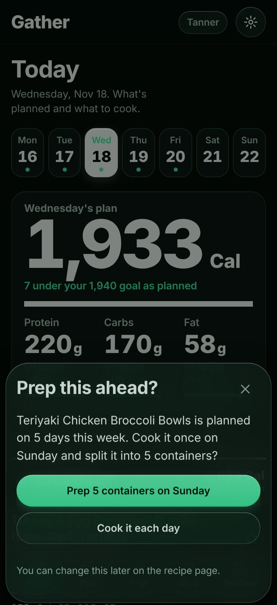 | 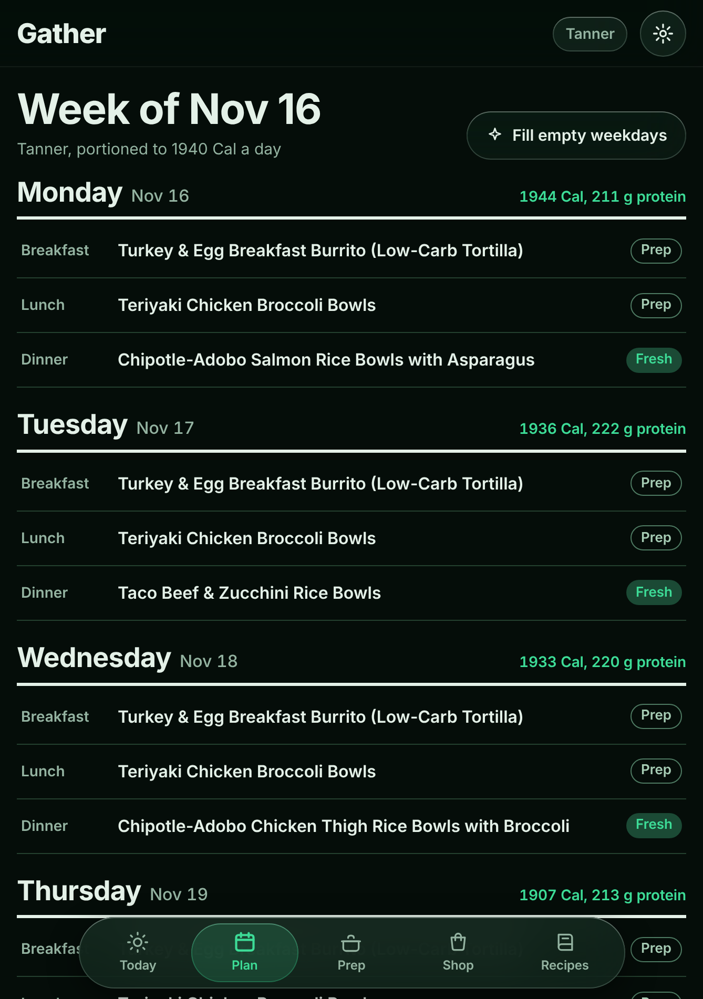 |
| 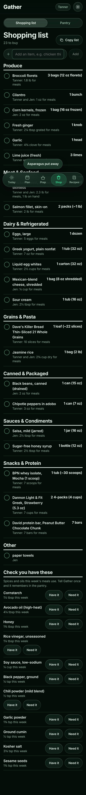 | 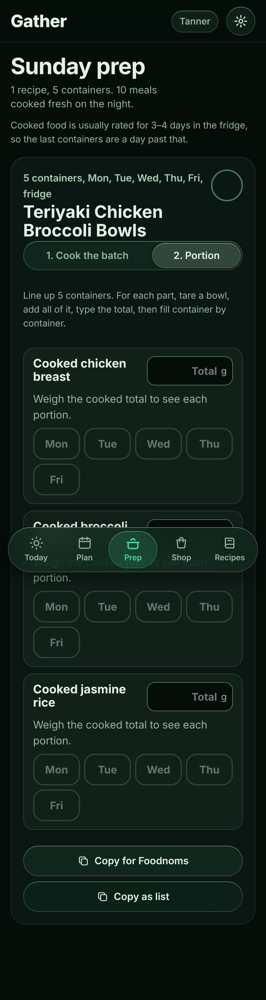 |
| 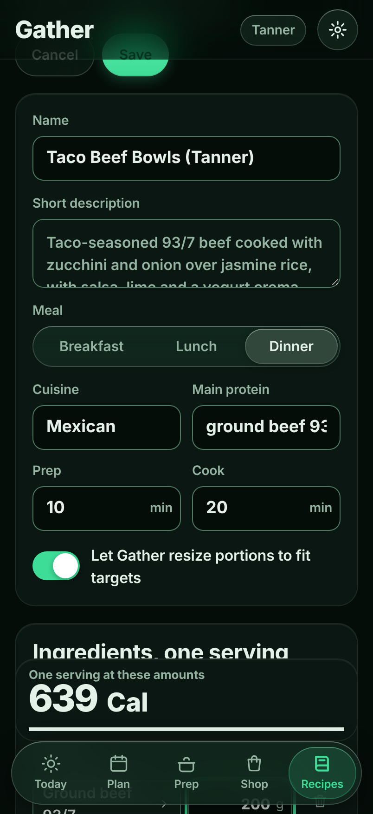 | 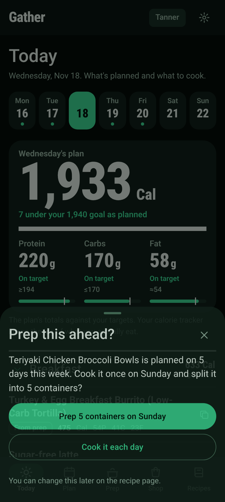 |
| 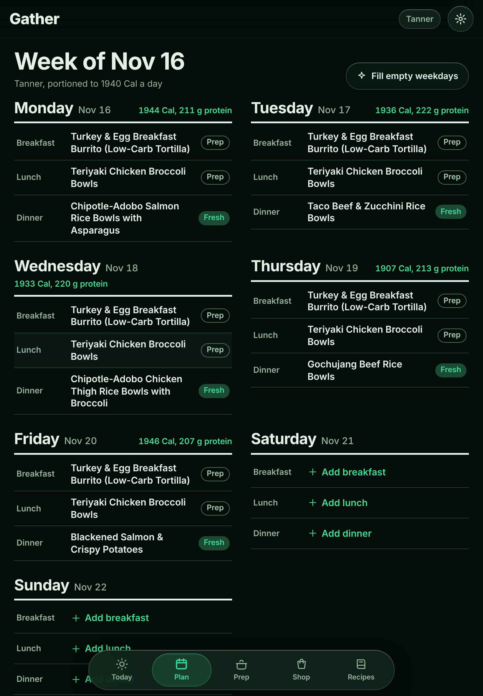 | 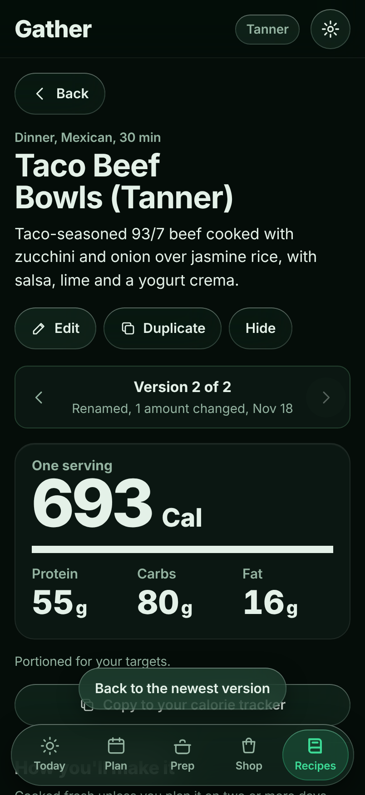 |
| 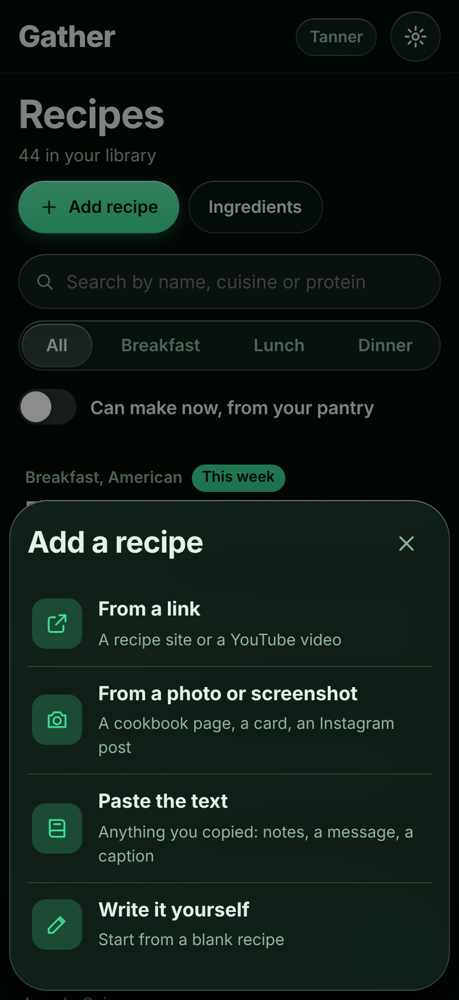 | 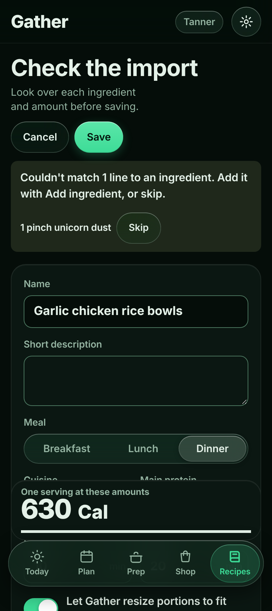 |
| 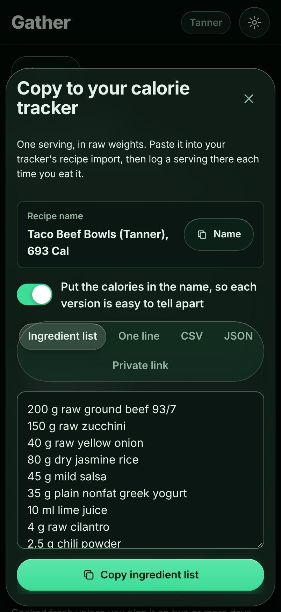 | 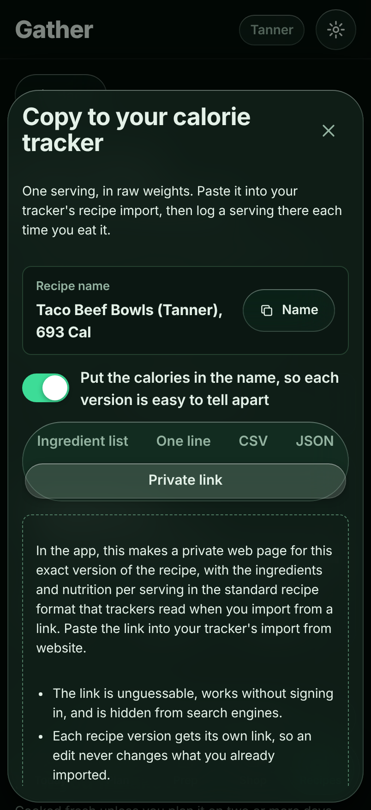 |
